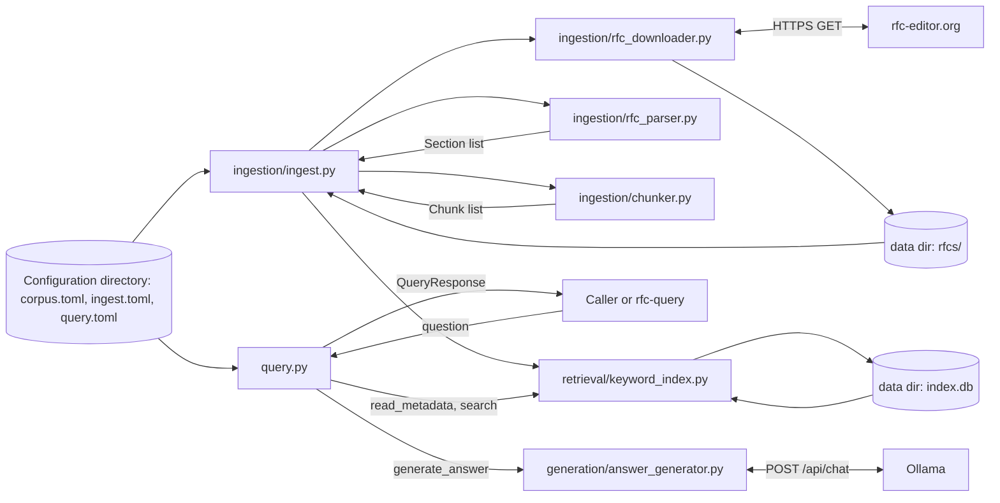
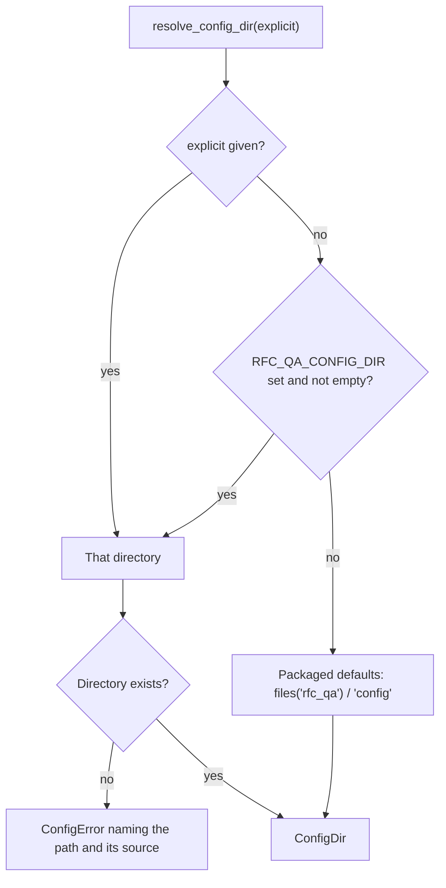
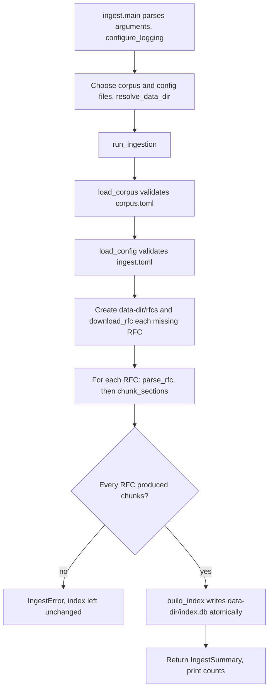
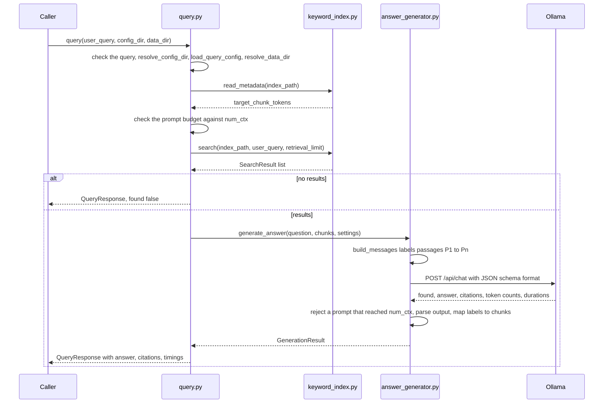
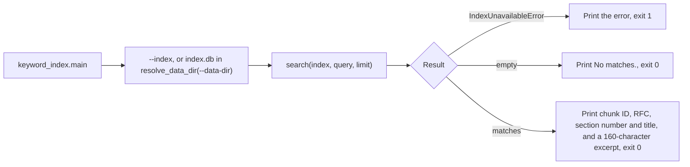
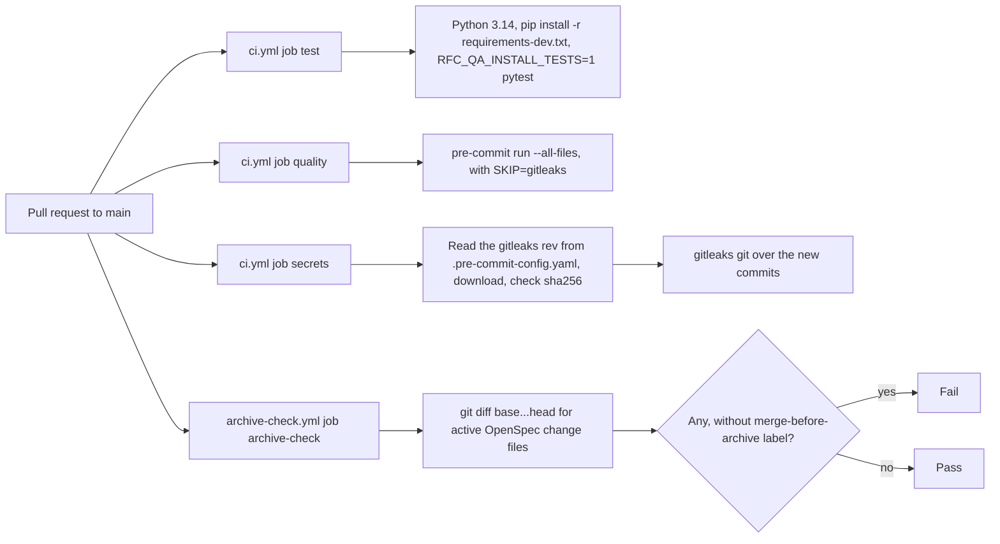
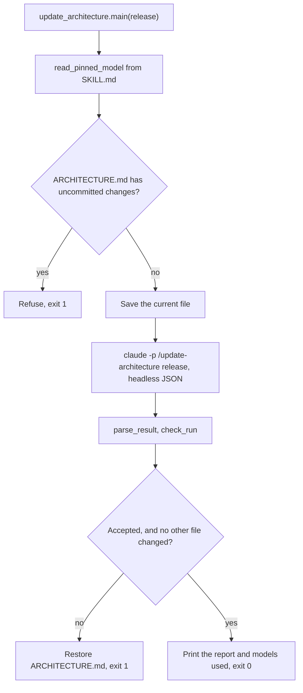

# Architecture

[Back to README](README.md)

## Overview

rfc-qa answers natural-language questions about a curated set of IETF RFCs, and cites the RFC
sections each answer came from. It is a retrieval-augmented generation (RAG) pipeline written by hand
as the installable Python package `rfc_qa`, in `src/rfc_qa/`. Its runtime dependencies are
`requests` and `platformdirs`, and it needs Python 3.14 or later.

The package has one subpackage per stage, `ingestion`, `retrieval` and `generation`, and a few shared
modules: `chunk.py` (the `Chunk` passed between stages), `paths.py` (which configuration and data
directories to use), `errors.py` (the exceptions the library raises) and `cli.py` (what the commands
share). The two halves share one file, the index `index.db` in the data directory:

- **Ingestion (offline).** `rfc_qa.ingestion.ingest` reads the manifest `corpus.toml` and the chunk
  settings in `ingest.toml` from the configuration directory. It downloads any missing RFC text from
  rfc-editor.org with `rfc_downloader`, splits each RFC into sections with `rfc_parser`, cuts sections
  into citable chunks with `chunker`, and writes every chunk to a SQLite FTS5 keyword index with
  `rfc_qa.retrieval.keyword_index`. The index also records the configuration that built it.
- **Querying (online).** `rfc_qa.query` is the main entry point. For each question it reads
  `query.toml`, checks that the retrieved passages and answer will fit the model's context window,
  retrieves the best-matching chunks with keyword search, and passes them to
  `rfc_qa.generation.answer_generator`. That module asks a local model served by Ollama to answer
  from those passages only, as structured JSON, then maps the passages the model cited back to the
  retrieved chunks. `query` returns the answer, its citations and timings in a `QueryResponse`.

The default configuration ships inside the package, in `src/rfc_qa/config/`, and is read with
`importlib.resources`. A flag or environment variable can select another configuration directory.
Generated data, the downloaded RFCs and the index, lives in the user's data directory for rfc-qa,
such as `~/.local/share/rfc-qa` on Linux, unless a flag or environment variable selects another.

Library code raises an `RfcQaError` subclass for a failure the user or the environment causes, and
never prints. It logs progress to loggers under `rfc_qa`, which stay silent unless a program
configures logging or a command is run with `-v`. The three commands report an error once, on
standard error.

A citation check proves that a cited passage was retrieved. It can't prove that the passage supports
the answer.

Development is supported by GitHub Actions workflows in `.github/workflows/` that gate pull
requests, a pre-commit configuration in `.pre-commit-config.yaml` with lint, format, type and secret
checks, and `scripts/update_architecture.py`, which regenerates this file with a pinned model.

## Workflows

### Choosing the configuration and data directories

1. `resolve_config_dir(explicit, explicit_source)` in `rfc_qa.paths` uses `explicit` if given, then
   `RFC_QA_CONFIG_DIR` if it's set and not empty, both made absolute from the working directory, and
   otherwise `packaged_config_dir()`. A selected directory that doesn't exist raises `ConfigError`,
   whose message names the path and where it came from, such as `--config-dir`. It returns a
   `ConfigDir`. A selected directory must provide every file it's asked for. The packaged defaults
   don't fill gaps.
2. `resolve_data_dir(explicit, explicit_source)` uses `explicit`, then `RFC_QA_DATA_DIR`, then
   `default_data_dir()`, which calls `platformdirs.user_data_dir("rfc-qa", appauthor=False)` each
   time. It returns a `SelectedDir` and never requires the directory to exist: ingestion creates it,
   and a query or search reports the missing index.
3. Each configuration file is read by `read_toml`, which raises `ConfigError` for a file that can't
   be opened or isn't valid TOML, with `tomllib`'s line and column in the message.

### Building the index

1. `ingest.main` parses the command line and calls `configure_logging`. `--corpus` and `--config`
   name files directly. Only for a file no flag names does it call `resolve_config_dir(--config-dir)`
   and take `corpus.toml` or `ingest.toml` from that directory. It then calls
   `resolve_data_dir(--data-dir)` and `run_ingestion(corpus_path, config_path, data_dir)`. Any
   `RfcQaError` is passed to `report_error`, which prints it to stderr, and the exit status is 1.
2. `load_corpus` reads the manifest and returns a list of `CorpusEntry`. The `rfcs` array must be
   non-empty, and each entry needs a positive integer `number`, a `family` from `FAMILIES` (`http`,
   `tls`, `tcp`) and a non-empty `title`. A repeated number is an error. Every problem raises
   `ConfigError`.
3. `load_config` reads `ingest.toml` and returns an `IngestConfig`, or raises `ConfigError`.
   `target_chunk_tokens` may not exceed `embedding_model.max_tokens`. `IngestConfig.max_chunk_chars`
   is `int(target_chunk_tokens * chars_per_token)`, and must be at least 1.
4. Ingestion creates `<data-dir>/rfcs/` if needed and calls `download_rfc(number, directory)` for
   every RFC whose `rfc<number>.txt` is missing. A `DownloadError` stops the run. `download_rfc`
   fetches `https://www.rfc-editor.org/rfc/rfc<number>.txt` with `Accept-Encoding: identity`, and
   verifies a 200 status, a non-empty body, the `Content-Length` when present and that the first
   4,096 bytes name the requested RFC. It writes the file through a temporary file, `fsync` and
   `os.replace`.
5. For each RFC in manifest order, the text is read as UTF-8 (undecodable bytes replaced) and passed
   to `parse_rfc`, which calls `remove_page_furniture` and returns the retained `Section` objects.
   `chunk_sections` then splits each section with `split_text` and returns `Chunk` objects carrying
   the manifest's title and family. An RFC that can't be read or produces no chunks raises
   `IngestError`.
6. Only after every RFC has produced chunks, `build_index(chunks, config.as_metadata(), path)` writes
   a new SQLite database to a temporary file in the same directory and moves it over
   `<data-dir>/index.db`. On failure it raises `IndexBuildError` and the old index is kept.
7. `run_ingestion` returns an `IngestSummary`, and `main` prints the RFC count, chunk count and
   largest chunk size.

### Answering a question

1. `query(user_query, *, config_dir=None, data_dir=None)` raises `TypeError` if `user_query` isn't a
   `str`, which is a bug in the caller. A string with no non-whitespace character returns
   `QueryErrorCode.INVALID_QUERY`.
2. `resolve_config_dir(config_dir, explicit_source="config_dir argument")` and
   `load_query_config` read `query.toml` and return a `QueryConfig`. A `ConfigError` returns
   `CONFIG_INVALID`. Neither of these first failures carries timings. `load_query_config` replaces
   `llm.base_url` with `OLLAMA_BASE_URL` when that's set and not empty, but the file must still give
   a valid `llm.base_url`.
3. `resolve_data_dir(data_dir, explicit_source="data_dir argument")` gives the index path,
   `<data dir>/index.db`.
4. A wall clock starts. `read_metadata` supplies the index's `target_chunk_tokens`. A missing or
   unreadable index, or a value that isn't an integer, raises `IndexUnavailableError`, which returns
   `INDEX_UNAVAILABLE`.
5. The budget check requires `retrieval.limit x target_chunk_tokens + PROMPT_ALLOWANCE_TOKENS (512) +
   llm.max_answer_tokens` to be no more than `llm.num_ctx`, or the query returns `CONFIG_INVALID`
   before any search or model call.
6. `search(index_path, user_query, retrieval_limit)` returns up to `limit` `SearchResult` objects,
   timed as `retrieval_ms`. An `IndexUnavailableError` returns `INDEX_UNAVAILABLE`. An empty list
   returns a successful not-found response without calling the model.
7. `generate_answer(question, chunks, settings)` builds the messages with `build_messages`, which
   sends `SYSTEM_PROMPT` and then the passages labeled `P1`, `P2` and so on in retrieval order, each
   with its RFC number, section number and section title, followed by the question. It posts one
   non-streaming request to `<base_url>/api/chat` with `temperature` 0, `num_ctx`, `num_predict` set
   to `max_answer_tokens`, and a JSON schema requiring `found`, `answer` and `citations`.
   - A timeout, a connection error, a missing model (HTTP 404 with "not found") or any other non-200
     status raises `ModelUnavailableError`, which returns `MODEL_UNAVAILABLE`.
   - A `prompt_eval_count` at or above `num_ctx`, a response that isn't a JSON object, or output
     without the expected fields raises `ModelResponseError`, which returns `MODEL_INVALID_RESPONSE`.
8. Cited labels are matched exactly, ignoring surrounding whitespace, against the labels sent.
   Unknown labels and repeats are dropped, keeping the order first cited. The result counts as
   answered only if the model said `found`, the answer text is non-empty and at least one citation
   is valid. Otherwise the answer text is discarded.
9. `query` builds `Timings` from the wall clock and Ollama's `load_duration`, `prompt_eval_duration`,
   `eval_duration`, `prompt_eval_count` and `eval_count`. `cold_start` is true when the model load
   took at least `COLD_START_THRESHOLD_MS` (500 ms).
10. An answered result returns `success` true, `found` true, the answer and one `Citation` per cited
    chunk. A not-answered result returns `success` true, `found` false and `NOT_FOUND_ANSWER`.

`query` catches only `ConfigError`, `IndexUnavailableError`, `ModelUnavailableError` and
`ModelResponseError`. Any other exception propagates.

`query.main` resolves `--config-dir` and `--data-dir` itself, so that an error names the flag, and
reports a `ConfigError` with exit status 1. It passes the configuration directory on to `query` only
when a flag or the environment chose it. It prints the answer and a `Sources:` list, and adds a note
when the answer was a cold start. On a failure response it prints `error_string` to stderr and exits
with status 1.

### Searching the index from the command line

`search` opens the index read-only through a `file:` URI with `mode=ro`, and raises
`IndexUnavailableError` for a missing file instead of creating one. It splits the query text into
word tokens, quotes each one and joins them with `OR`, so that user text is never read as FTS
syntax. It ranks with BM25, weighting a match in the section title 10 times a match in the body,
breaks ties by chunk ID, and returns the negated BM25 value as `score`, so a higher score is a better
match. Once the index is open, text with no word tokens, or a `limit` of 0 or less, returns an empty
list.

### Showing progress with `-v`

Each command's `main` calls `add_verbose_argument` and then `configure_logging(args.verbose)` from
`rfc_qa.cli`. With no `-v`, nothing is configured, so the output is only the result. With `-v`, one
`StreamHandler` on standard error is attached to the `rfc_qa` logger at `INFO`, and with `-vv` at
`DEBUG`, in the format `%(levelname)s %(name)s: %(message)s`. A later call replaces the handler
instead of adding another. The root logger isn't touched. `rfc_qa/__init__.py` attaches a
`NullHandler` to `rfc_qa`, so a program that doesn't configure logging sees nothing.

Each module logs to `logging.getLogger(__name__)`:

- `INFO`: the manifest size, each download, the chunk totals, the index write, the retrieval count
  and time, and whether the model answered and how many passages it cited.
- `DEBUG`: the chosen configuration and data directories, the query configuration and index paths,
  an RFC already stored, the bytes stored, each RFC's section and chunk counts, each search, the
  context budget, the model request and the model's token counts and durations.

### Checking a pull request

- `.github/workflows/ci.yml` runs on pull requests to `main` and on pushes to `main`, with three jobs:
  - `test` installs `requirements-dev.txt` on Python 3.14, which includes an editable install of
    the package, and runs `pytest` with `RFC_QA_INSTALL_TESTS=1`. Tests marked `integration` and
    `ollama` in `pytest.ini` need `RFC_DOWNLOADER_NETWORK_TESTS=1` and `OLLAMA_TESTS=1`, which CI
    doesn't set. The `install` test builds a wheel and installs it in a fresh environment.
  - `quality` runs `pre-commit run --all-files`, skipping the gitleaks hook. The hooks in
    `.pre-commit-config.yaml` are `ruff check`, `ruff format --check` and `mypy` on the whole
    project, run from the project's environment, and `gitleaks` on staged changes.
  - `secrets` checks out the full history, reads the gitleaks `rev` from `.pre-commit-config.yaml`,
    downloads that release's `linux_x64` archive, checks it against the release's checksums file,
    and runs `gitleaks git --redact` over the pull request's commits, or over the pushed range.
- `.github/workflows/archive-check.yml` runs the `archive-check` job on pull requests to `main`,
  including label changes. It fails when the pull request adds or modifies files under
  `openspec/changes/` outside `openspec/changes/archive/`, unless the pull request has the
  `merge-before-archive` label.

Both workflows set `permissions: contents: read`.

### Regenerating ARCHITECTURE.md

1. `main` rejects an empty release or one containing whitespace, then calls
   `update_architecture(ROOT, release)`.
2. `read_pinned_model` reads the `model:` field from the frontmatter of
   `.claude/skills/update-architecture/SKILL.md`, and requires a full model ID rather than an alias.
3. The script records the changed and untracked files from `git status`, and refuses to run if
   `ARCHITECTURE.md` is among them. It saves the file's current content, if any.
4. It runs `claude -p "/update-architecture <release>" --model <pinned> --output-format json` with
   the tools in `ALLOWED_TOOLS` and `--permission-mode acceptEdits`.
5. `parse_result` takes the last JSON object in the output. `check_run` accepts the run only if the
   exit status is 0, `is_error` is false, the pinned model appears in `modelUsage`, and it produced
   more output tokens than every other model listed.
6. Any file other than `ARCHITECTURE.md` that changed during the run rejects it, and those files
   are listed but left as they are.
7. On rejection, `ARCHITECTURE.md` is restored, or deleted if it didn't exist, and an
   `ArchitectureError` is printed. On acceptance the run's report is printed with the models used,
   followed by a reminder to review and commit the file.

## Public interfaces

### Query API (`rfc_qa.query`)

`query(user_query, *, config_dir=None, data_dir=None) -> QueryResponse` answers one question.
`config_dir` and `data_dir` are optional path strings. Expected failures are returned in the
response, not raised. A `user_query` that isn't a `str` raises `TypeError`. It reads `query.toml`
and opens the index on every call.

`QueryResponse` (mutable dataclass):

| Field | Type | Meaning |
|---|---|---|
| `success` | `bool` | Whether the query completed, including a not-found result |
| `answer` | `str \| None` | The answer, or `NOT_FOUND_ANSWER` when not found, or `None` on failure |
| `found` | `bool \| None` | Whether the indexed RFCs answered the question; `None` on failure |
| `citations` | `list[Citation]` | Cited sections, in the order first cited; empty unless `found` |
| `timings` | `Timings \| None` | `None` only when the query is empty or configuration loading fails |
| `error_string` | `str \| None` | A message for people, on failure |
| `error_code` | `QueryErrorCode \| None` | The failure kind, on failure |

`Citation` (frozen dataclass): `chunk_id: str`, `rfc_number: int`, `rfc_title: str`,
`section_number: str`, `section_title: str`.

`Timings` (frozen dataclass): `total_ms: int`, then `retrieval_ms`, `model_load_ms`,
`generation_ms`, `prompt_tokens` and `answer_tokens`, all `int | None` and `None` when that stage
didn't run, and `cold_start: bool`. `generation_ms` is Ollama's prompt evaluation plus generation
time.

`QueryErrorCode` (`IntEnum`). Its docstring says values may be renumbered until the first release,
and that after it a removed value is retired and not reused.

| Member | Value | Returned when |
|---|---|---|
| `INVALID_QUERY` | 1 | The query has no non-whitespace character |
| `INDEX_UNAVAILABLE` | 2 | The index is missing or can't be read, or doesn't record a usable `target_chunk_tokens` |
| `MODEL_UNAVAILABLE` | 3 | Ollama can't be reached, times out, lacks the model or returns an HTTP error |
| `MODEL_INVALID_RESPONSE` | 4 | Ollama's output isn't usable JSON, or the prompt reached `num_ctx` |
| `CONFIG_INVALID` | 5 | The configuration directory is missing, `query.toml` is unreadable or invalid, or the prompt budget doesn't fit `num_ctx` |

`NOT_FOUND_ANSWER`, defined in `rfc_qa.generation.answer_generator`, is the text "The indexed RFCs
don't answer this question."

### Errors (`rfc_qa.errors`)

Every library failure that the user, the configuration or the environment causes raises a subclass
of `RfcQaError`, and `str()` of it is a message ready to show. A mistake in the calling code raises
the built-in `TypeError` or `ValueError` instead.

| Class | Raised when |
|---|---|
| `RfcQaError` | The base class; not raised directly |
| `ConfigError` | A configuration directory is missing, or a configuration file can't be read or is invalid |
| `DownloadError` | An RFC couldn't be downloaded, verified or stored |
| `IngestError` | A stored RFC can't be read, or produces no chunks |
| `IndexUnavailableError` | The index is missing or can't be read |
| `IndexBuildError` | The index couldn't be written |
| `ModelUnavailableError` | Ollama couldn't produce a response; the message says how to fix it, such as `ollama serve` or `ollama pull <model>` |
| `ModelResponseError` | Ollama responded, but its output can't be used |

### Command lines

`pyproject.toml` defines three console scripts. Each also takes `-v`/`--verbose`, repeatable, to
show progress on standard error.

| Command | Entry point | Arguments | Output and exit status |
|---|---|---|---|
| `rfc-ingest` | `rfc_qa.ingestion.ingest:main` | `--config-dir`; `--corpus` and `--config`, which name a manifest or ingestion configuration file instead of the one in the configuration directory; `--data-dir` | Prints RFC count, chunk count and largest chunk; exits 0, or 1 with the error on stderr |
| `rfc-query QUERY` | `rfc_qa.query:main` | `query`: the question; `--config-dir`; `--data-dir` | Prints the answer, `Sources:` and any cold-start note; exits 0, including not found, or 1 with the error on stderr |
| `rfc-search QUERY` | `rfc_qa.retrieval.keyword_index:main` | `query`: the search text; `--data-dir`; `--index`, an index file instead of the one in the data directory; `--limit` (default 5) | Prints each match's chunk ID, RFC, section number and title, and an excerpt, or `No matches.`; exits 1 only if the index can't be read |
| `python scripts/update_architecture.py RELEASE` | `main` | `release`: one word, such as `v0.1.0` | Prints the run's report and models used; exits 0 when kept, or 1 when refused or rejected |

`argparse` errors exit with status 2.

### Environment variables

| Variable | Effect |
|---|---|
| `RFC_QA_CONFIG_DIR` | The configuration directory, when no `--config-dir` or `config_dir` is given |
| `RFC_QA_DATA_DIR` | The data directory, when no `--data-dir` or `data_dir` is given |
| `OLLAMA_BASE_URL` | Replaces `llm.base_url` from `query.toml` |

Each is ignored when empty. A relative directory resolves from the working directory.

### Configuration files

The configuration directory holds three TOML files. The packaged defaults are in
`src/rfc_qa/config/` and are installed with the package. Unknown keys are ignored.

`corpus.toml` lists the RFCs to index, as an array `rfcs` of inline tables. The list must be
non-empty, with no number repeated. It holds 59 RFCs today: 24 `http`, 17 `tls` and 18 `tcp`.

| Field | Type | Rule |
|---|---|---|
| `number` | integer | Greater than 0; not a boolean |
| `family` | string | One of `http`, `tls`, `tcp` |
| `title` | string | Non-empty; used as the RFC title in chunks and citations |

`ingest.toml` sets the chunk size limit.

| Field | Type | Value today | Rule |
|---|---|---|---|
| `target_chunk_tokens` | integer | 1100 | Positive, at most `embedding_model.max_tokens` |
| `chars_per_token` | number | 1.6 | Positive |
| `embedding_model.name` | string | `nomic-embed-text` | Non-empty; recorded in the index only |
| `embedding_model.max_tokens` | integer | 2048 | Positive; ceiling for `target_chunk_tokens` |

The maximum chunk size is `int(target_chunk_tokens x chars_per_token)` characters, 1,760 today.

`query.toml` sets retrieval and model settings. The index location isn't set here: it's always
`index.db` in the data directory.

| Field | Type | Value today | Rule |
|---|---|---|---|
| `retrieval.limit` | integer | 5 | Positive; passages retrieved per query |
| `llm.model` | string | `llama3.2` | Non-empty; Ollama model name |
| `llm.base_url` | string | `http://localhost:11434` | Non-empty; Ollama address, which `OLLAMA_BASE_URL` can replace |
| `llm.num_ctx` | integer | 8192 | Positive; context window requested from Ollama |
| `llm.max_answer_tokens` | integer | 512 | Positive; sent as `num_predict` |
| `llm.timeout_seconds` | number | 120 | Positive; request timeout |

### Generated data

The data directory defaults to `platformdirs.user_data_dir("rfc-qa", appauthor=False)`:

- `rfcs/rfc<number>.txt`: the downloaded RFC text, exactly as served.
- `index.db`: a SQLite database with a `metadata` table (`key`, `value`, both text) holding the
  `IngestConfig.as_metadata()` values (`embedding_model_name`, `embedding_max_tokens`,
  `chars_per_token`, `target_chunk_tokens`, `max_chunk_chars`), a `chunks` table with one row per
  chunk, holding an integer `id` and a column for each `Chunk` field, and an external-content FTS5
  table `chunks_fts` over `section_title` and `text` with the `porter unicode61` tokenizer.

Chunk IDs have the form `rfc<number>-s<section>[-<n>]-p<position>`, for example
`rfc9110-s15.5.5-p0`. `<position>` counts from 0 within a section. When an RFC repeats a section
number, the second and later sections with that number get `-2`, `-3` and so on. The unnumbered
`Abstract` and `Security Considerations` sections use the section numbers `abstract` and `security`.

## Internal interfaces

### `rfc_qa.chunk`

- `Chunk` (frozen dataclass): `chunk_id: str`, `rfc_number: int`, `rfc_title: str`, `family: str`,
  `section_number: str`, `section_title: str`, `text: str`. `text` keeps the source line layout.

### `rfc_qa.paths`

- `SelectedDir` (frozen dataclass): `path: str`, `source: str`. `file(name) -> str` joins a file
  name to the path.
- `ConfigDir` (frozen dataclass): `location: Traversable`, `source: str`. The property `is_packaged`
  is true for the packaged defaults, and `file(name) -> Traversable` returns `location / name`.
- `ConfigFile`: the type `str | Traversable`, a path or a file in a configuration directory.
- `as_traversable(file) -> Traversable`: turns a path string into a `Path`.
- `read_toml(file) -> dict[str, Any]`: the parsed TOML document, raising `ConfigError`.
- `packaged_config_dir() -> Traversable`: `files("rfc_qa") / "config"`.
- `resolve_config_dir(explicit=None, explicit_source="--config-dir") -> ConfigDir`: raises
  `ConfigError` for a selected directory that doesn't exist.
- `default_data_dir() -> str` and `resolve_data_dir(explicit=None, explicit_source="--data-dir") ->
  SelectedDir`.
- Constants: `CONFIG_DIR_ENV`, `DATA_DIR_ENV`, `CORPUS_FILE`, `INGEST_CONFIG_FILE`,
  `QUERY_CONFIG_FILE`, `PACKAGED_CONFIG_SOURCE`, `APP_NAME`, `RFCS_FOLDER` and `INDEX_FILE`.

### `rfc_qa.cli`

- `report_error(message) -> int`: prints `message` to stderr and returns 1.
- `add_verbose_argument(parser) -> None`: adds `-v`/`--verbose` with `action="count"`.
- `configure_logging(verbosity) -> None`: shows the `rfc_qa` records on stderr, as described under
  Workflows.

### `rfc_qa.ingestion.rfc_downloader`

- `download_rfc(rfc_number, directory) -> str`: stores the RFC as `<directory>/rfc<number>.txt` and
  returns that path, without downloading when the file already exists. Raises `TypeError` for a
  number that isn't an `int` or is a `bool`, `ValueError` for one below 1, and `DownloadError` for a
  missing directory, a request error, a non-200 status, a failed check or a failed write, leaving no
  file behind. It doesn't create the directory.
- `HTTP_TIMEOUT`: `(10, 30)`, the connect and read timeouts in seconds.

### `rfc_qa.ingestion.rfc_parser`

- `Section` (frozen dataclass): `number: str`, `title: str`, `text: str`. `text` keeps the source
  line layout and can be empty.
- `remove_page_furniture(text) -> str`: normalizes line endings, and where the text has form feeds,
  removes page headers, `[Page n]` footers and the blank lines around each break.
- `parse_rfc(text) -> list[Section]`: returns the retained sections in document order. Front matter,
  the table of contents, and back matter such as references, acknowledgments, author addresses and
  the index are dropped, including the subsections of a dropped numbered section. Of the
  unnumbered sections, only `Abstract` and `Security Considerations` are kept.

### `rfc_qa.ingestion.chunker`

- `split_text(text, max_chars) -> list[str]`: returns parts of at most `max_chars`, packing
  paragraphs greedily, then lines for an oversized paragraph, and cutting a line only when it can't
  fit alone. Whitespace-only text no longer than `max_chars` returns an empty list. There is no
  overlap.
- `chunk_sections(sections, rfc_number, rfc_title, family, max_chars) -> list[Chunk]`: chunks one
  RFC's sections and assigns chunk IDs. Sections with no body text produce no chunks.

### `rfc_qa.ingestion.ingest`

- `CorpusEntry` (frozen dataclass): `number: int`, `family: str`, `title: str`.
- `IngestConfig` (frozen dataclass): `embedding_model_name: str`, `embedding_max_tokens: int`,
  `chars_per_token: float`, `target_chunk_tokens: int`. The property `max_chunk_chars` returns the
  limit in characters, and `as_metadata()` returns the dict that `build_index` stores.
- `IngestSummary` (frozen dataclass): `rfc_count: int`, `chunk_count: int`,
  `largest_chunk_chars: int`.
- `load_corpus(path) -> list[CorpusEntry]` and `load_config(path) -> IngestConfig`: validate a
  `ConfigFile`, raising `ConfigError`.
- `run_ingestion(corpus_path, config_path, data_dir) -> IngestSummary`: the whole build. Raises
  `ConfigError`, `DownloadError`, `IngestError` or `IndexBuildError`.
- `main(argv=None) -> int`: the `rfc-ingest` command line.
- `FAMILIES`: `("http", "tls", "tcp")`.

### `rfc_qa.retrieval.keyword_index`

All SQL in the project is in this module.

- `SearchResult` (frozen dataclass): `chunk: Chunk`, `score: float`, where higher is better.
- `build_index(chunks, metadata, path) -> None`: writes a new index from an iterable of `Chunk` and
  a mapping of metadata, replacing `path` atomically. Raises `IndexBuildError` on failure, leaving
  any existing index and no temporary file.
- `read_metadata(path) -> dict[str, str]`: the `metadata` table. Raises `IndexUnavailableError` if
  the index is missing or unreadable.
- `search(path, query_text, limit=DEFAULT_LIMIT) -> list[SearchResult]`: up to `limit` results,
  best first, or an empty list when nothing matches. Raises `IndexUnavailableError` if the index is
  missing or can't be read or searched.
- `main(argv=None) -> int`: the `rfc-search` command line.
- `DEFAULT_LIMIT`: 5.

### `rfc_qa.generation.answer_generator`

- `ModelSettings` (frozen dataclass): `model: str`, `base_url: str`, `num_ctx: int`,
  `max_answer_tokens: int`, `timeout_seconds: float`.
- `GenerationResult` (frozen dataclass): `found: bool`, `answer: str | None`, `cited: list[Chunk]`
  of the cited chunks, then `model_load_ms`, `generation_ms`, `prompt_tokens` and `answer_tokens`,
  each `int | None`. When `found` is false, `answer` is `None` and `cited` is empty.
- `build_messages(question, chunks) -> list[dict[str, str]]`: the system and user chat messages.
- `generate_answer(question, chunks, settings) -> GenerationResult`: one model call, with checked
  citations. Raises `ModelUnavailableError` or `ModelResponseError` when no usable answer comes
  back.
- `SYSTEM_PROMPT` and `NOT_FOUND_ANSWER`.

### `rfc_qa.query`

Besides the public API above:

- `QueryConfig` (frozen dataclass): `retrieval_limit: int`, `model: ModelSettings`.
- `load_query_config(path) -> QueryConfig`: validates a `ConfigFile`, applies `OLLAMA_BASE_URL`, and
  raises `ConfigError`.
- `main(argv=None) -> int`: the `rfc-query` command line.
- `OLLAMA_BASE_URL_ENV`, `PROMPT_ALLOWANCE_TOKENS` (512) and `COLD_START_THRESHOLD_MS` (500).

### `scripts/update_architecture.py`

- `ArchitectureError`: a reason not to run, or not to keep a result.
- `read_pinned_model(skill_path) -> str`: the full model ID from the skill's frontmatter.
- `parse_result(stdout) -> dict[str, Any] | None`: the last JSON object in headless output.
- `describe_usage(result) -> str`: each model in `modelUsage` with its output tokens.
- `check_run(exit_code, result, pinned_model) -> str | None`: `None` to keep the run, otherwise the
  reason to reject it.
- `update_architecture(root, release) -> str`: runs the skill and returns its report, raising
  `ArchitectureError` after restoring `ARCHITECTURE.md`.
- `main(argv=None) -> int`: the command line.
- `ROOT`, `SKILL_RELATIVE_PATH`, `DOC_RELATIVE_PATH` and `ALLOWED_TOOLS`.

## Key decisions

| Decision | Why | Assumption to revisit | Status | Last reviewed | Source |
|---|---|---|---|---|---|
| RFCs come only from rfc-editor.org plaintext, verified by `Content-Length` and the RFC number in the header | The canonical source is authoritative and already plaintext. It publishes no checksum, so these checks catch truncation and wrong documents | rfc-editor.org keeps serving `rfc<n>.txt` with a `Content-Length` header, and still publishes no checksum | Current | v0.1.0 | [add-rfc-downloader design](openspec/changes/archive/2026-11-07-add-rfc-downloader/design.md) |
| `corpus.toml` records number, family and title, and no status | A manifest is easy to review. Cover pages vary too much to read titles from. Status needs its own source of truth | Status-aware retrieval still hasn't been built, and the 59 RFCs and their obsolete pairs still match the RFC Editor's index | Current | v0.2.0 | [add-rfc-ingestion design](openspec/changes/archive/2026-11-07-add-rfc-ingestion/design.md) |
| Section headings are found by shape and by section order, with fixed lists of unnumbered titles | Order rejects numbered lists without a rule per era. Tested against all 59 RFCs, with a fixture for each layout | The corpus uses only the four layouts sampled, and no new RFC breaks the order or title rules | Current | v0.1.0 | [add-rfc-ingestion design](openspec/changes/archive/2026-11-07-add-rfc-ingestion/design.md) |
| Chunk size is a character limit derived from `ingest.toml`, so ingestion doesn't need Ollama | Keeps ingestion, tests and CI free of a model service, and keeps the hard ceiling apart from the tunable target | No embeddings are made yet. Once they are, `max_tokens` should be checked against Ollama and `truncate: false` passed | Current | v0.2.0 | [add-rfc-ingestion design](openspec/changes/archive/2026-11-07-add-rfc-ingestion/design.md) |
| `chars_per_token` is 1.6 | The lowest ratio measured across every chunk, rounded down, because dense ASCII tables reached 1.67 | Same corpus and embedding model, and dense tables still justify smaller chunks for everything | Current | v0.1.0 | [add-rfc-ingestion design](openspec/changes/archive/2026-11-07-add-rfc-ingestion/design.md) |
| Chunks split at paragraphs, then lines, with no overlap, and IDs like `rfc9110-s15.5.1-p0` derived from the document | Overlap adds near-duplicate text. Document-derived IDs are readable and stable for citations | The golden set doesn't show a need for overlap or semantic chunking, and nothing outside stores chunk IDs that a format change would break | Current | v0.1.0 | [add-rfc-ingestion design](openspec/changes/archive/2026-11-07-add-rfc-ingestion/design.md) |
| SQLite FTS5 with BM25 for keyword search, in one index file | One file, BM25 built in and no new dependency. `rank_bm25` needs a dependency and loads everything into memory | Local Chroma still lacks BM25, as of chromadb 1.5.9, and FTS5 is present in every Python build used | Current | v0.1.0 | [add-rfc-ingestion design](openspec/changes/archive/2026-11-07-add-rfc-ingestion/design.md) |
| The retrieval boundary is `build_index` and `search`, with all SQL in `keyword_index.py` | Keyword, vector and hybrid search differ in inputs and scores, so a generic database interface wouldn't fit. A formal interface waits for a second backend | Only one retrieval backend exists | Current | v0.1.0 | [add-rfc-ingestion design](openspec/changes/archive/2026-11-07-add-rfc-ingestion/design.md) |
| Ollama's `/api/chat` is called directly with `requests`, using a JSON schema for structured output | One request, no new dependency, and the spike showed the schema produces valid JSON reliably | Ollama's structured output stays reliable for the configured model, and its API keeps the `format` field and duration fields | Current | v0.1.0 | [add-answer-generation design](openspec/changes/archive/2026-11-07-add-answer-generation/design.md) |
| Passages are labeled `P1` to `Pn`, and code maps cited labels back to chunks | The only format where good answers cited correctly in the spike. Full IDs broke good answers | `llama3.2` remains the model. A citation proves retrieval, not support, and invented answers can cite real labels | Current | v0.1.0 | [add-answer-generation design](openspec/changes/archive/2026-11-07-add-answer-generation/design.md) |
| Not found is a success, and an answer with no valid citations is treated as not found | The system worked correctly, and step 2 can score not found separately from failures | Callers and evaluation still treat not found as an outcome rather than an error | Current | v0.1.0 | [add-answer-generation design](openspec/changes/archive/2026-11-07-add-answer-generation/design.md) |
| The prompt budget is checked before the model call, using `target_chunk_tokens` from the index, and a `prompt_eval_count` at `num_ctx` fails the query | Ollama shortens an over-long prompt without an error, so the service must not answer from a partial prompt | The 512-token allowance covers the instructions and question, and Ollama still truncates silently and reports `prompt_eval_count` | Current | v0.1.0 | [add-answer-generation design](openspec/changes/archive/2026-11-07-add-answer-generation/design.md) |
| `QueryErrorCode` values are retired when removed, never reused or renumbered, since the v0.1.0 release | Once a release exists, callers outside the repository can depend on the values. Before v0.1.0 no outside caller did, so values were renumbered to stay consecutive | Callers outside the repository may store or compare the numeric values, so the codes stay part of the public interface | Current | v0.2.0 | [add-answer-generation design](openspec/changes/archive/2026-11-07-add-answer-generation/design.md) |
| Ollama loads the model on demand, and a load of at least 500 ms marks a cold start | A preliminary check would add a call to every query, and the request already reports its load time | Measured loads stay far from 500 ms: about 2 ms warm and 4,852 ms cold. `keep_alive` stays at Ollama's default | Current | v0.1.0 | [add-answer-generation design](openspec/changes/archive/2026-11-07-add-answer-generation/design.md) |
| `scripts/update_architecture.py` enforces the pinned model by checking `modelUsage` after a headless run | A skill's `model` field fails open when a policy blocks the model, and a fallback model can take over | Claude Code skills still can't refuse to run on a model mismatch. A helper model may still appear in `modelUsage`, but with less output | Current | v0.1.0 | [add-architecture-generator design](openspec/changes/archive/2026-11-07-add-architecture-generator/design.md) |
| The library raises one family of exceptions, `RfcQaError` in `errors.py`, and never prints. `query()` maps four subclasses to the existing `QueryErrorCode` values, and each command reports an error once with `report_error` | A caller can catch every failure in one place or one kind with `except`. A single class with a code attribute would tie the errors to `QueryErrorCode`, and caller bugs stay `TypeError` and `ValueError` | The only callers of `download_rfc`, `build_index`, `read_metadata` and `search` are in this repository, and no failure other than the four mapped subclasses can happen in a query | Current | v0.2.0 | [consistent-error-handling design](openspec/changes/archive/2026-11-20-consistent-error-handling/design.md) |
| The default configuration ships inside the package in `src/rfc_qa/config/`, is read through `importlib.resources`, and a selected configuration directory must provide every file | One copy of the defaults, which works from a regular install outside a checkout, without a context manager around every command | pip installs the package as files on disk, so `str()` of a packaged file is a real path in error messages | Current | v0.2.0 | [run-outside-checkout design](openspec/changes/archive/2026-11-20-run-outside-checkout/design.md) |
| The data directory defaults to `platformdirs.user_data_dir("rfc-qa", appauthor=False)`, can be changed only by `--data-dir`, `data_dir` or `RFC_QA_DATA_DIR`, and always holds `index.db` | A query from any working directory finds the index, and the platform rules for macOS and Windows are easy to get wrong by hand | `platformdirs` stays small, typed and free of dependencies. CI runs only on Linux, so the macOS and Windows defaults are untested | Current | v0.2.0 | [run-outside-checkout design](openspec/changes/archive/2026-11-20-run-outside-checkout/design.md) |
| Configuration is TOML, read by the standard library's `tomllib` through one reader, `paths.read_toml`, with validation in code and no schema library | Every setting can carry a comment in the file, and a malformed file is reported with its line and column, with no new dependency | The library never needs to write configuration, because `tomllib` has no writer, and no JSON fallback is needed because the project isn't deployed | Current | v0.2.0 | [toml-config design](openspec/changes/archive/2026-11-20-toml-config/design.md) |
| The gitleaks version is pinned once, as the pre-commit hook's `rev`, and CI's `secrets` job downloads that release and checks its checksum | One version for the commit hook and CI, so a change that bumps the hook changes CI in the same commit | gitleaks keeps publishing a `linux_x64` archive and a checksums file under the same names for each release | Current | v0.2.0 | [add-secret-scanning design](openspec/changes/archive/2026-11-19-add-secret-scanning/design.md) |

---

Generated from commit dbd7e34 by claude-opus-5-5, for release v0.2.0.
